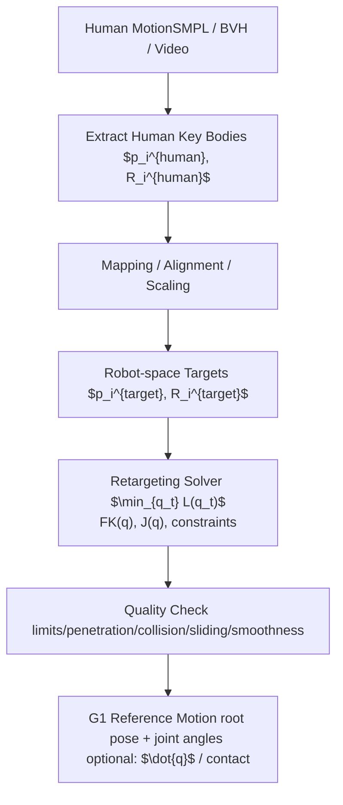

# GVHMR+GMR 重定向

## 演示视频

### 秧歌

流程: 下载视频 -> GVHMR 估计人体运动 -> GMR 重定向到 Unitree G1 -> 生成视频

<figure>
<video width="100%" controls src="../public/projects/retarget/gvhmr-duochanbu.mp4"></video>
<figcaption>跺颤步</figcaption>
</figure>
<figure>
<video width="100%" controls src="../public/projects/retarget/gmr-duochanbu.mp4"></video>
<figcaption>跺颤步</figcaption>
</figure>
<figure>
<video width="100%" controls src="../public/projects/retarget/gvhmr-gouxiongduosuomao.mp4"></video>
<figcaption>狗熊哆嗦毛</figcaption>
</figure>

<figure>
<video width="100%" controls src="../public/projects/retarget/gmr-gouxiongduosuomao.mp4"></video>
<figcaption>狗熊哆嗦毛</figcaption>
</figure>

<!-- <figure>
<video width="100%" controls src="../public/projects/retarget/gvhmr-langzitiqiu.mp4"></video>
<figcaption>浪子踢球</figcaption>
</figure>

<figure>
<video width="100%" controls src="../public/projects/retarget/gvhmr-langzitiqiu.mp4"></video>
<figcaption>浪子踢球</figcaption>
</figure> -->

<figure>
<video width="100%" controls src="../public/projects/retarget/gvhmr-shanshenbu.mp4"></video>
<figcaption>闪身步</figcaption>
</figure>

<figure>
<video width="100%" controls src="../public/projects/retarget/gmr-shanshenbu.mp4"></video>
<figcaption>闪身步</figcaption>
</figure>

<figure>
<video width="100%" controls src="../public/projects/retarget/gvhmr-tibeigu.mp4"></video>
<figcaption>提背鼓</figcaption>
</figure>

<figure>
<video width="100%" controls src="../public/projects/retarget/gmr-tibeigu.mp4"></video>
<figcaption>提背鼓</figcaption>
</figure>

<figure>
<video width="100%" controls src="../public/projects/retarget/gvhmr-yaotouhuangnao.mp4"></video>
<figcaption>摇头晃脑</figcaption>
</figure>

<figure>
<video width="100%" controls src="../public/projects/retarget/gmr-yaotouhuangnao.mp4"></video>
<figcaption>摇头晃脑</figcaption>
</figure>

### 行走与奔跑

<figure>
<video width="100%" controls src="../public/projects/amp/unitree_g1_B4_-_Stand_to_Walk_backwards_stageii.mp4"></video>
<figcaption>倒着走</figcaption>
</figure>

<figure>
<video width="100%" controls src="../public/projects/amp/unitree_g1_C14_-__run_turn_right__(90)_stageii.mp4"></video>
<figcaption>右转弯跑</figcaption>
</figure>

<figure>
<video width="100%" controls src="../public/projects/amp/unitree_g1_C17_-_run_change_direction_stageii.mp4"></video>
<figcaption>不同方向跑</figcaption>
</figure>

<figure>
<video width="100%" controls src="../public/projects/amp/unitree_g1_Run_C25_-_quick_side_step_right_stageii.mp4"></video>
<figcaption>跳步</figcaption>
</figure>

<figure>
<video width="100%" controls src="../public/projects/amp/unitree_g1_hmr4d_results.mp4"></video>
<figcaption>网球发球</figcaption>
</figure>

## GVHMR 的原理、方法与流程

### 一、基本原理

世界坐标系下的人体运动恢复（World-Grounded Human Motion Recovery）旨在从单目视频中重建连续的三维人体运动，并要求运动位于一个重力感知的世界坐标系中。该任务的核心困难在于世界坐标系的定义本身具有歧义：给定重力方向后，绕重力轴的任意旋转都构成一个合法的重力感知世界坐标系，因此不同序列之间的全局朝向无法统一。已有方法通常以自回归方式预测相邻帧间的相对运动，但这种方式容易在长序列中累积误差，尤其在重力方向上难以保持一致性。

GVHMR 的基本思想是：对于每一帧图像，人类可以直观地推断出图像中人物的重力感知姿态；并且对于相邻两帧，估计绕重力方向的单自由度旋转远比估计完整的三自由度旋转更加容易和鲁棒。基于这一观察，GVHMR 提出了一种新的 Gravity-View（GV）坐标系，该坐标系由世界重力方向与相机视线方向共同定义。由于 GV 坐标系天然与重力对齐，且对于每一帧图像都是唯一确定的，因此它大幅降低了图像到姿态映射的学习歧义。网络在 GV 坐标系下逐帧预测人体朝向，而不同帧的 GV 坐标系之间的相对旋转仅发生在绕重力轴的方向上，从而可以系统地避免重力方向上的累积误差。最后，利用相机相对旋转将所有帧的预测结果变换到一个统一的重力感知世界坐标系中，形成全局运动序列。由于每帧独立预测，GVHMR 避免了自回归方法的误差累积，并且可以并行处理长序列。

### 二、方法设计

#### 2.1 Gravity-View 坐标系

给定相机空间中的重力方向 $\vec{g}$ 与相机视线方向 $\overrightarrow{view}=[0, 0, 1]^T$，GV 坐标系的三个坐标轴定义如下：首先令 $y$ 轴与重力方向对齐，即 $\vec{y}=\vec{g}$；然后令 $x$ 轴同时垂直于重力方向与相机视线方向，即 $\vec{x}=\vec{y}\times\overrightarrow{view}$；最后根据右手定则得到 $z$ 轴，即 $\vec{z}=\vec{x}\times\vec{y}$。由此，人体在 GV 坐标系下的朝向可表示为
$$
\Gamma_{GV} = R_{c2GV}\cdot\Gamma_{c} = [\vec{x}, \vec{y}, \vec{z}]^{T}\cdot\Gamma_{c}, 
$$
其中 $\Gamma_{c}$ 为相机坐标系下的人体朝向。由于 GV 坐标系由输入图像直接确定，因此 $\Gamma_{GV}$ 是定义良好且与重力对齐的学习目标。

#### 2.2 全局轨迹恢复

对于静态相机，所有帧的 GV 坐标系完全相同，因此人体全局朝向 $\{\Gamma_{w}^{t}\}$ 直接等于 $\{\Gamma_{GV}^{t}\}$。全局平移 $\{\tau_{w}^{t}\}$ 由预测的局部根速度 $v_{root}$ 经朝向变换后累加得到：
$$
\tau_{w}^{t} = \begin{cases}
[0, 0, 0]^{T}, & t = 0, \\
\sum_{i=0}^{t-1}\Gamma_{w}^{i}v_{root}^{i}, & t > 0.
\end{cases}
$$

对于动态相机，需要计算相邻帧 GV 坐标系之间的相对旋转 $R_{\Delta GV}^{t}$。首先计算第 $t$ 帧从相机到 GV 坐标系的旋转 $R_{c2gv}^{t} = \Gamma_{GV}^{t}\cdot(\Gamma_{c}^{t})^{-1}$，然后将相机视线方向变换到 GV 坐标系：
$$
\overrightarrow{view}_{GV}^{t} = R_{c2gv}^{t}\cdot[0, 0, 1]^{T}.
$$
利用相机相对旋转 $R_{\Delta}^{t}$ 将视线方向旋转到第 $t-1$ 帧：
$$
\overrightarrow{view}_{c}^{t-1} = (R_{\Delta}^{t})^{-1}\cdot\overrightarrow{view}_{c}^{t}.
$$
由于 $R_{\Delta GV}^{t}$ 仅绕重力轴旋转，可通过将两帧视线方向投影到 $xz$ 平面并计算夹角得到。得到所有 $\{R_{\Delta GV}^{t}\}$ 后，将所有帧的朝向滚动到第一帧的 GV 坐标系：
$$
\Gamma_{w}^{t} = \begin{cases}
\Gamma_{GV}^{0}, & t = 0, \\
\prod_{i=1}^{t}R_{\Delta GV}^{i}\cdot\Gamma_{GV}^{t}, & t > 0.
\end{cases}
$$
该式同样适用于静态相机，此时 $R_{\Delta GV}^{t}$ 为单位矩阵。全局平移仍按上式累加得到。

#### 2.3 网络设计

网络输入包括四类特征：人体边界框、二维关键点、图像特征以及相对相机旋转。这些特征经各自的 MLP 映射到相同维度后逐元素相加，得到每帧的 token $f_{\mathrm{token}}^{t}\in\mathbb{R}^{512}$。Token 序列输入一个 Relative Transformer，其中采用旋转位置编码（RoPE）来注入相对位置信息。RoPE 下的自注意力输出为
$$
\begin{aligned}
\mathbf{o}^{t} &= \sum_{i\in T}\mathrm{Softmax}\left(\mathbf{a}^{ts}\right)^{i}\mathbf{W}_{v}f_{\mathrm{token}}^{i}, \\
a^{ts} &= (\mathbf{W}_{q}f_{\mathrm{token}}^{t})^{\top}\mathbf{R}\left(\mathbf{p}^{s}-\mathbf{p}^{t}\right)(\mathbf{W}_{k}f_{\mathrm{token}}^{s}), 
\end{aligned}
$$
其中 $\mathbf{R}(\cdot)$ 为旋转编码矩阵，$\mathbf{p}^{t}$ 为时间索引。推理时引入注意力掩码
$$
m^{ts} = \begin{cases}
0, & \text{if } -L < t-s < L, \\
-\infty, & \text{otherwise}, 
\end{cases}
$$
使得每个 token 仅关注相对距离在 $L$ 以内的 token，从而可泛化到任意长序列而无需滑动窗口。

Transformer 输出经多任务 MLP 预测多个目标：弱透视相机参数 $cw$、相机坐标系人体朝向 $\Gamma_{c}$、SMPL 局部姿态 $\theta$、形状 $\beta$、关节静止概率 $p_{j}$、GV 坐标系朝向 $\Gamma_{GV}$ 以及根速度 $v_{root}$。相机坐标系下的人体运动通过 CLIFF 方法从弱透视转换到全透视。世界坐标系下的人体运动则按上述全局轨迹恢复方法得到。

后处理阶段，利用预测的手、脚尖、脚跟的静止概率，逐帧更新全局平移，使静止关节尽可能保持空间固定；随后计算各关节的精细静止位置，并通过逆运动学求解局部姿态，以减轻脚滑等物理不合理现象。

<!-- ### 三、训练流程

训练时，首先对输入视频进行预处理，提取边界框、二维关键点、图像特征和相对相机旋转，并融合为每帧 token。Token 序列输入 Relative Transformer，输出多任务预测结果。损失函数包括：对除静止概率外的所有预测目标使用均方误差损失，对静止概率使用二元交叉熵损失；此外还对三维关节、二维关节、顶点、相机坐标系平移以及世界坐标系平移施加 L2 损失。模型在 AMASS、BEDLAM、H36M 和 3DPW 的混合数据集上从零开始训练，训练序列长度设为 $L=120$，批量大小为 256，在两张 RTX 4090 上训练约 13 小时。

推理时，给定单目视频，先进行预处理，然后网络并行预测每帧的中间表示。根据相机是否运动，分别采用静态或动态全局轨迹恢复算法，将 GV 坐标系下的朝向与根速度转换为世界坐标系下的全局轨迹。最后利用静止概率进行后处理，优化全局平移并求解局部姿态，输出最终的重力感知世界坐标系人体运动。

### 四、伪代码

<pre class="pseudocode">
\documentclass{article}
\usepackage{algorithm}
\usepackage{algpseudocode}
\usepackage{amsmath}
\usepackage{amssymb}
\usepackage{bm}

\begin{document}

\begin{algorithm}
\caption{GVHMR 推理流程}
\begin{algorithmic}[1]
\Require 单目视频 $\{I^t\}_{t=0}^T$
\Ensure 世界坐标系下的人体运动 $\{\theta^t, \beta, \Gamma_w^t, \tau_w^t\}$
\State 预处理：提取边界框、二维关键点、图像特征、相对相机旋转 $R_{\Delta}^t$
\State 将特征融合为每帧 token $f_{\mathrm{token}}^t$
\State 使用 Relative Transformer 与 RoPE 处理 token 序列
\State 经多任务 MLP 预测 $\Gamma_c^t, \theta^t, \beta, \Gamma_{GV}^t, v_{root}^t, p_j^t, cw^t$
\State 由 $cw^t$ 恢复相机坐标系平移 $\tau_c^t$
\If{相机静止}
    \State $\Gamma_w^t \leftarrow \Gamma_{GV}^t$
    \State $\tau_w^t \leftarrow \sum_{i=0}^{t-1} \Gamma_w^i v_{root}^i$
\Else
    \For{每一帧 $t$}
        \State $R_{c2gv}^t \leftarrow \Gamma_{GV}^t \cdot (\Gamma_c^t)^{-1}$
        \State $\overrightarrow{view}_{GV}^t \leftarrow R_{c2gv}^t \cdot [0,0,1]^T$
        \State $\overrightarrow{view}_{c}^{t-1} \leftarrow (R_{\Delta}^t)^{-1} \cdot \overrightarrow{view}_{c}^{t}$
        \State 将 $\overrightarrow{view}^{t-1}$ 与 $\overrightarrow{view}^t$ 投影到 $xz$ 平面，计算 $R_{\Delta GV}^t$
    \EndFor
    \State $\Gamma_w^0 \leftarrow \Gamma_{GV}^0$
    \For{$t=1,\dots,T$}
        \State $\Gamma_w^t \leftarrow \prod_{i=1}^{t} R_{\Delta GV}^i \cdot \Gamma_{GV}^t$
    \EndFor
    \State $\tau_w^t \leftarrow \sum_{i=0}^{t-1} \Gamma_w^i v_{root}^i$
\EndIf
\State 利用静止概率 $p_j^t$ 更新全局平移 $\tau_w^t$
\State 通过逆运动学求解局部姿态 $\theta^t$，减轻脚滑
\State \Return $\{\theta^t, \beta, \Gamma_w^t, \tau_w^t\}$
\end{algorithmic}
\end{algorithm}
\end{document}
</pre> -->

## GMR 原理与方法

GMR 的核心原理在于：将人体运动到人形机器人的重定向视为一个先进行人体—机器人关键身体匹配、静止姿态对齐与非均匀局部缩放，再通过两阶段微分逆运动学求解机器人广义坐标的过程。其基本出发点是，PHC 与 ProtoMotions 等方法在源运动缩放阶段容易引入偏离源运动、脚滑、地面穿透与自交等伪影，而缩放策略正是影响重定向质量的关键因素。因此，GMR 并不直接沿用全局统一缩放或简单轴向缩放，而是采用一种简单但灵活的非均匀局部缩放方式，使不同关键身体能够依据其在人体与机器人之间的形态差异分别缩放，并在后续优化中同时兼顾身体朝向、末端执行器位置以及全部关键身体的位置约束，从而在保持源运动忠实性的同时提高机器人运动跟踪策略的可学习性与鲁棒性。

在方法上，GMR 首先要求用户根据源人体骨架与目标人形机器人骨架定义关键身体之间的映射 $\mathcal{M}$，这些关键身体通常包括躯干、头部、腿部、足部、手臂与手部。随后，在人体与机器人均处于静止姿态时，对源人体对应身体的朝向进行偏移，使其与机器人对应身体的朝向一致；在部分情况下，还可对某些身体的位置施加局部偏移，以缓解诸如内八脚等重定向伪影。接着，GMR 对源人体数据进行非均匀局部缩放。其首先依据源人体骨架高度计算一个总体缩放因子，并以此调整每个关键身体各自定义的局部缩放因子，从而能够分别考虑上下肢等不同身体部位之间的缩放差异。目标身体在笛卡尔空间中的位置由下式给出：

$$
\mathbf{p}_{b}^{\mathrm{target}} = \frac{h}{h_{\mathrm{ref}}} s_{b}(\mathbf{p}_{j}^{\mathrm{source}} - \mathbf{p}_{\mathrm{root}}^{\mathrm{source}}) + \frac{h}{h_{\mathrm{ref}}} s_{\mathrm{root}}\mathbf{p}_{\mathrm{root}}^{\mathrm{source}}, 
$$

其中 $h$ 为源人体骨架高度，$h_{\mathrm{ref}}$ 为设定缩放因子时所采用的参考高度，$\mathbf{p}_{b}$ 表示身体位置，$s_{b}$ 为身体 $b$ 对应的缩放因子。当所处理的身体为根节点时，上式退化为：

$$
\mathbf{p}_{\mathrm{root}}^{\mathrm{target}} = \frac{h}{h_{\mathrm{ref}}} s_{\mathrm{root}}\mathbf{p}_{\mathrm{root}}^{\mathrm{source}}.
$$

特别地，根平移采用统一缩放因子进行缩放，对于避免引入脚滑伪影具有关键作用。

在获得目标笛卡尔位置后，GMR 通过求解机器人逆运动学来获得机器人广义坐标 $\mathbf{q}$，其中包括根平移、根旋转与关节值。为避免陷入局部最优，GMR 采用两阶段优化过程。第一阶段仅考虑身体朝向以及末端执行器位置，其优化问题为：

$$
\begin{array}{rl}
\min_{\mathbf{q}} & \sum_{(i, j)\in \mathcal{M}}(w_1)_{i, j}^R\| R_i^b\ominus R_j(\mathbf{q})\| _2^2\\
& +\sum_{(i, j)\in \mathcal{M}}(w_1)_{i, j}^p\| \mathbf{p}_i^{\mathrm{target}} - \mathbf{p}_j(\mathbf{q})\| _2^2
\end{array}
$$

其中，$R_i^b\in SO(3)$ 为人体身体 $i$ 的朝向，$\mathbf{p}_j(\mathbf{q})$ 与 $R_j(\mathbf{q})\in SO(3)$ 分别为通过前向运动学得到的机器人身体 $j$ 的笛卡尔位置与朝向，$R_i\ominus R_j$ 表示二者朝向差的指数映射，$\mathcal{M}_{\mathrm{ee}}$ 为仅包含末端执行器即手与足的关键身体子集，$(w_1)_{i, j}^p$ 与 $(w_1)_{i, j}^R$ 分别为第一阶段的位置与朝向误差权重。$\mathbf{q}$ 中的根位置与根朝向分量由缩放后的根位置 $\mathbf{p}_{\mathrm{root}}^{\mathrm{target}}$ 以及人体根关键身体朝向的偏航分量初始化。该优化受关节上下限 $\mathbf{q}^{-}$ 与 $\mathbf{q}^{+}$ 约束，且在某些情况下需要收紧关节范围以避免非人运动。GMR 使用微分逆运动学求解器 Mink 求解该问题，即不直接寻找使代价最小的 $\mathbf{q}$，而是计算广义速度 $\dot{\mathbf{q}}$，使其积分后能够降低代价：

$$
\begin{array}{rl}
\min_{\mathbf{q}} & \| e(\mathbf{q}) + J(\mathbf{q})\dot{\mathbf{q}}\| _W^2\\
\mathrm{subject~to} & \mathbf{q}^{-}\leq \mathbf{q} + \dot{\mathbf{q}}\Delta t\leq \mathbf{q}^{+}
\end{array}
$$

其中，$e(\mathbf{q})$ 为第一阶段优化中的损失函数，$J(\mathbf{q}) = \frac{\partial e}{\partial \mathbf{q}}$ 为该损失相对于 $\mathbf{q}$ 的雅可比矩阵，$W$ 为由位置与朝向权重诱导得到的权重矩阵，$\Delta t$ 为微分逆运动学求解器的参数。求解过程持续至收敛，即价值函数变化小于阈值 $0.001$，或达到最大迭代次数 $10$。

第二阶段则以第一阶段所得解为初值，进一步使用旋转与平移约束进行微调，其目标函数为：

$$
\begin{array}{rl}
\min_{\mathbf{q}} & \sum_{(i, j)\in \mathcal{M}}(w_2)_{i, j}^R\| R_i^b\ominus R_j(\mathbf{q})\| _2^2\\
& +(w_2)_{i, j}^p\| \mathbf{p}_i^{\mathrm{target}} - \mathbf{p}_j(\mathbf{q}^r)\| _2^2
\end{array}
$$

该阶段采用不同于第一阶段的权重 $(w_2)_{i, j}^p$ 与 $(w_2)_{i, j}^R$，并考虑所有关键身体的位置信息，其终止条件与第一阶段相同。对于运动序列，GMR 将上述单帧重定向方法逐帧顺序应用，并将前一帧的重定向结果作为下一帧第四步优化的初始猜测。当整段运动完成重定向后，再利用前向运动学计算所有机器人身体随时间变化的高度，并将最小高度从全局平移中减去，以修正漂浮或地面穿透等高度伪影。由此，GMR 形成了一套从人体—机器人关键身体匹配、静止姿态对齐、非均匀局部缩放，到两阶段逆运动学优化与序列高度后处理的完整重定向流程。

## Unitree G1 重定向求解流程

